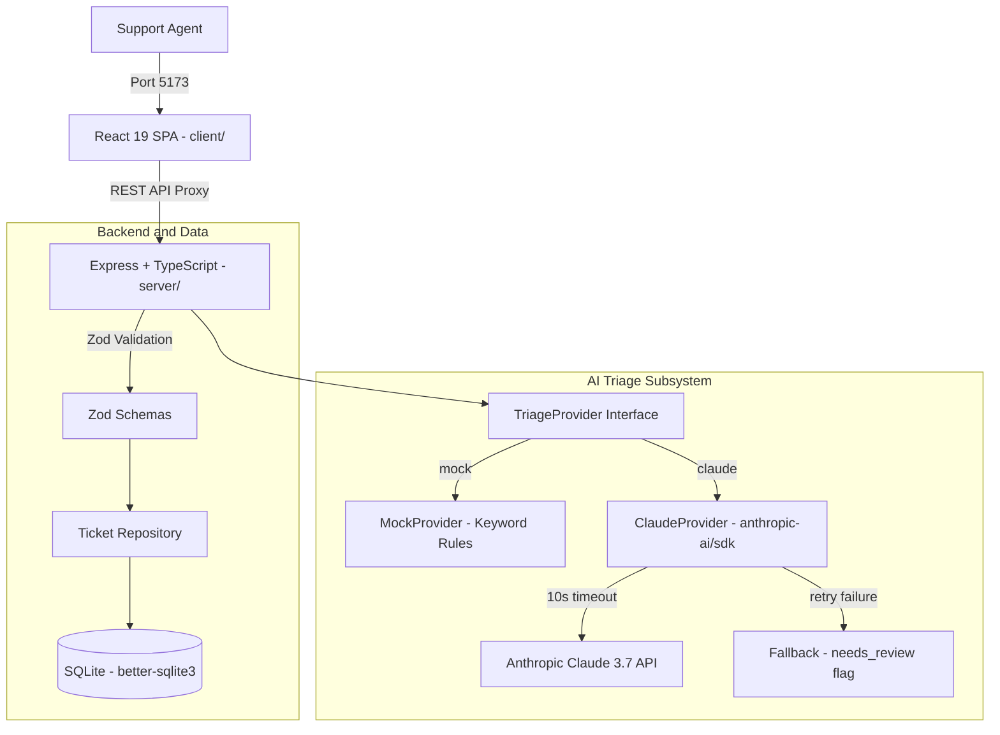

# TriageDesk

[](https://github.com/GhileaLucian/triagedesk/actions/workflows/ci.yml)
[](https://www.typescriptlang.org/)
[](https://react.dev/)
[](https://expressjs.com/)
[](https://sqlite.org/)
[](https://opensource.org/licenses/MIT)

> **Autonomous AI support ticket triage platform.** Ingests unstructured customer inquiries, classifies category and priority using Claude 3.7 / keyword mock rules with prompt injection defense, and provides an actionable React 19 dashboard for support teams.

---

## Features

- **Agentic AI Classification**: Powered by Claude API (`CLAUDE_MODEL=claude-3-7-sonnet-20250219`) via a pluggable `TriageProvider` architecture with schema validation and retry logic.
- **Offline Mock Provider**: Out-of-the-box deterministic keyword classifier (`TRIAGE_PROVIDER=mock`) requiring zero API keys for local development and CI testing.
- **Prompt Injection Defense**: Explicit system prompt sandboxing isolating untrusted user text from execution instructions.
- **Fail-Safe Fallback**: Automatic 2-attempt retry loop falling back to `"other/medium"` with a persistent `needs_review: 1` badge on LLM rate-limit or timeout.
- **React 19 Dashboard**: High-density support desk UI with real-time statistics, multi-criteria filters (status, priority, category, full-text search), modal creation, and ticket status transition flows.
- **SQLite Persistence**: Embedded persistence via `better-sqlite3` with WAL mode for high concurrency and `:memory:` isolation during unit tests.
- **Automated Test Coverage**: 30 comprehensive unit and integration tests across Supertest HTTP endpoints and Testing Library component suites.

---

## Architecture



---

## Quick Start

### 1. Clone and Install

```bash
git clone https://github.com/GhileaLucian/triagedesk.git
cd triagedesk

npm install
npm --prefix server install
npm --prefix client install
```

### 2. Configure Environment

```bash
cp .env.example .env
```

By default, `TRIAGE_PROVIDER=mock` is active and requires no API key. To use Claude 3.7, set `TRIAGE_PROVIDER=claude` and add your `ANTHROPIC_API_KEY`.

### 3. Seed Database and Launch

```bash
npm run seed
npm run dev
```

Open `http://localhost:5173` in your browser.

---

## Environment Variables

| Variable | Default | Description |
|---|---|---|
| `PORT` | `3001` | Express HTTP server port |
| `NODE_ENV` | `development` | Runtime environment: `development`, `production`, `test` |
| `DATABASE_PATH` | `./triagedesk.sqlite` | SQLite database file path |
| `TRIAGE_PROVIDER` | `mock` | Triage classifier: `mock` (offline keyword rules) or `claude` |
| `ANTHROPIC_API_KEY` | *(empty)* | Anthropic API key from `console.anthropic.com` |
| `CLAUDE_MODEL` | `claude-3-7-sonnet-20250219` | Anthropic model identifier |

---

## REST API Reference

| Method | Endpoint | Description |
|---|---|---|
| `GET` | `/api/health` | Health check returning status and timestamp |
| `GET` | `/api/tickets` | List tickets with filters: `status`, `priority`, `category`, `search` |
| `GET` | `/api/tickets/:id` | Fetch ticket by ID; returns 404 if not found |
| `POST` | `/api/tickets` | Create ticket: validates schema, runs triage, persists |
| `PATCH` | `/api/tickets/:id` | Update status: `open`, `in_progress`, or `resolved` |
| `POST` | `/api/tickets/:id/retriage` | Re-classify ticket with the active triage provider |
| `GET` | `/api/stats` | Aggregate counts by status, priority, category, and review flag |

---

## Testing

Run the full test suite from the project root:

```bash
npm test
```

- **Backend (24 tests)**: Vitest + Supertest covering endpoint validation, filter queries, 400/404 error paths, stats, and AI provider edge cases.
- **Frontend (6 tests)**: Vitest + Testing Library covering ticket list rendering, empty states, and form validation.

---

## How I Used Claude Code

TriageDesk was built using Anthropic's Claude Code agentic CLI as a pair-programming tool:

- **Architecture Scaffolding**: Claude Code generated initial Express TypeScript templates, SQLite repository patterns, and React component structures.
- **Iterative Corrections**: When the agent inlined SQLite instances (blocking test isolation), I refactored `db.ts` to accept a `:memory:` parameter. When JSON parsing lacked markdown fence stripping, I added the cleanup and prompt injection insulation.
- **Full Traceability**: All prompts, agent outputs, and manual corrections are documented in [AI_LOG.md](./AI_LOG.md).

---

## Next Steps

- Role-based authentication (OAuth2 / GitHub login).
- Real-time WebSocket updates when tickets are retriaged.
- Slack webhook dispatcher for high-priority tickets.

---

## License

Released under the [MIT License](./LICENSE). Copyright (c) 2026 Dan Lucian Ghilea.
